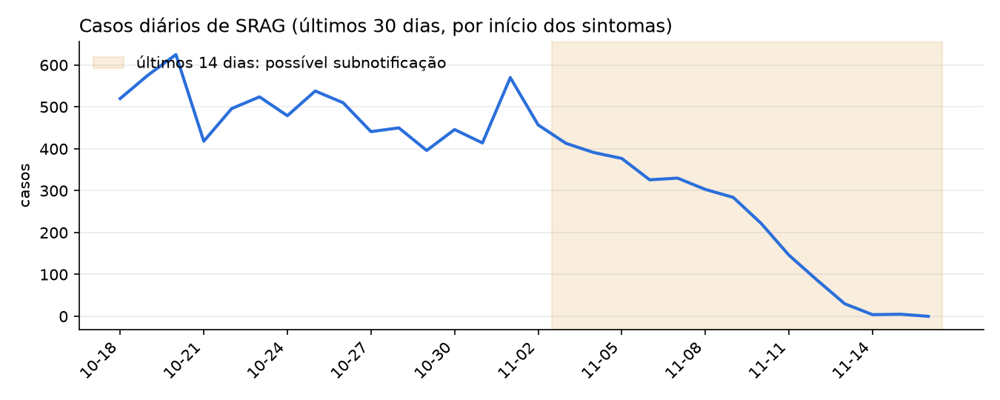
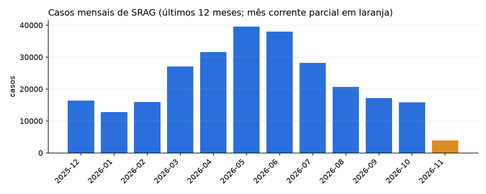

# Agente de relatórios sobre SRAG

PoC (desafio AI Engineer, Indicium): um agente orquestrador consulta a base de SRAG do SUS e notícias em tempo real e gera um relatório com 4 métricas, 2 gráficos e comentários sobre o cenário atual.

Diagrama conceitual da arquitetura (PDF): [`docs/arquitetura.pdf`](docs/arquitetura.pdf)


## Resultado de exemplo
Relatório gerado em 16/11/2026 (dados até essa data; relatório completo em [`docs/exemplo_execucao/report.md`](docs/exemplo_execucao/report.md)):

| Métrica | Valor | Detalhe |
|---|---|---|
| Taxa de aumento de casos | -10,6% | 15.125 vs 16.913 casos em janelas de 30 dias (bruta, sem ajuste de atraso: -34,2%) |
| Taxa de mortalidade | 5,7% | 13.315 óbitos / 233.092 casos com desfecho (12,4% em aberto) |
| Internações com passagem por UTI | 28,1% | 68.119 / 242.871 (aproximação da ocupação de UTI) |
| Casos vacinados (COVID-19) | 40,7% | 110.103 / 270.454 (aproximação da cobertura vacinal) |




O relatório traz ainda comentários sobre o cenário, cada um ligado a uma notícia real recuperada pela tool `search_news`, e a seção de metodologia e auditoria. As janelas ajustadas excluem os últimos 14 dias; por isso a taxa bruta (-34,2%) é bem menor que a ajustada: parte da queda é só atraso de notificação, e o gráfico diário marca essa faixa.

## Como rodar
**Pré-requisitos:** Linux/WSL/macOS, Python 3.12 (no Ubuntu: `sudo apt install python3-venv`), cerca de 4 GB de RAM livres e ~3 GB de disco para o modelo. Não precisa de GPU nem de chave de API.

Rode tudo a partir da raiz do repositório:
```
python3 -m venv .venv
.venv/bin/pip install -r requirements.txt
.venv/bin/python scripts/download_data.py     # --date dd-mm-aaaa para outra versão do "banco vivo"
.venv/bin/python -m srag.ingest
```
LLM local (padrão, sem chave e sem custo). Instale o Ollama (pede `sudo`):
```
curl -fsSL https://ollama.com/install.sh | sh
```
Confirme que o serviço responde; se der erro de conexão, inicie-o **em outro terminal** e deixe aberto (o comando não retorna):
```
ollama list
ollama serve
```
Baixe o modelo (~2 GB); `ollama list` deve mostrá-lo depois. Sem ele, o `srag.run` falha com um erro HTTP do Ollama:
```
ollama pull qwen2.5:3b
```
Gerar o relatório e rodar os testes:
```
.venv/bin/python -m srag.run                    # cria reports/<run_id>/report.md + PNGs e logs/<run_id>.jsonl
.venv/bin/python -m pytest
```
Sem GPU, uma execução leva de 1 a 2 minutos. O modelo de 3B às vezes erra o formato ou cita notícia inexistente; o guardrail descarta o comentário (após uma tentativa de correção) e o relatório sai com um aviso explícito, sem inventar conteúdo.

**Outro provedor de LLM (opcional):** crie um `.env` na raiz com `LLM_PROVIDER=gemini` e `GEMINI_API_KEY=<sua chave>` (ou `LLM_PROVIDER=anthropic` e `ANTHROPIC_API_KEY=<sua chave>`). `LLM_MODEL` troca o modelo. O `.env` está no `.gitignore`.

## Arquitetura (e por quê)
- **Loop de tool use próprio sobre um LLM intercambiável**, sem framework de agentes: o fluxo é curto e fechado, e um loop explícito é mais simples de auditar do que um grafo.
- **3 tools** (`get_metrics`, `generate_charts`, `search_news`), com SQL fixo no DuckDB e sem SQL livre do modelo. O LLM decide a ordem das chamadas e a consulta de notícias, e redige os comentários. Se esquecer uma tool obrigatória, o código a chama e registra isso na auditoria. Na prática, com o modelo de 3B padrão, o modelo costuma chamar só `search_news` e o código completa `get_metrics` e `generate_charts`; por isso o relatório não depende de o modelo seguir o fluxo, e cada tool forçada aparece no relatório e no log. Um modelo maior (`LLM_MODEL`) tende a seguir o fluxo sozinho.
- **Modelo dimensionado à tarefa:** `qwen2.5:3b` rodando local no Ollama por padrão: sem custo, sem chave e nenhum dado sai da máquina. `LLM_PROVIDER=gemini` ou `anthropic` troca de provedor e `LLM_MODEL` troca o modelo. O provedor fica atrás de uma interface mínima (`srag/llm.py`). Modelos pequenos erram mais, e é por isso que os guardrails e o preenchimento das tools pelo código existem. O modelo não calcula nada: só orquestra e escreve texto sobre agregados.
- **O LLM não escreve números.** Os valores do relatório vêm das tools, montados por template, com a origem (`tool_call_id`) de cada métrica.

Exemplo real de execução (relatório, gráficos e log de auditoria): [`docs/exemplo_execucao/`](docs/exemplo_execucao/). Para verificar a integridade: `sha256sum docs/exemplo_execucao/audit_log.jsonl` deve dar o mesmo valor registrado na seção "Auditoria" do relatório.

## Governança e transparência
- **Log JSONL por execução** (`logs/<run_id>.jsonl`): chamadas de tool (parâmetros e resultado), cada turno do LLM (texto, tokens, modelo), tools forçadas pelo código, falhas e bloqueios de guardrail. Chaves e tokens são redigidos.
- **Reprodutibilidade:** o relatório registra `run_id`, modelo, arquivos de origem, data de ingestão, hash da base limpa e o **sha256 do log**.
- **Notícias:** snapshot salvo em `cache/news_<run_id>.json`, com fonte, data e link de cada notícia citada.
- Se as notícias falharem, o relatório sai com aviso explícito, sem inventar contexto.

## Guardrails
1. Allowlist de tools; tool desconhecida é bloqueada e auditada.
2. Validação dos comentários do LLM: sem números soltos (percentuais, contagens, anos; nomes como "Covid-19" passam) e cada comentário deve citar ao menos um **id de notícia** (`n1`, `n2`, ...) devolvido por `search_news`; o código converte os ids em links. Se a resposta for rejeitada, o motivo volta ao modelo para **uma** tentativa de correção; se falhar de novo, os comentários são descartados e o relatório avisa.
3. Texto de notícia tratado como dado não confiável: só título/fonte/data/link, sem caracteres de controle, tamanho limitado, em bloco delimitado com instrução de ignorar ordens.
4. Limite de 6 iterações por execução.

## Dados sensíveis
A base aberta não traz nomes, mas combinações de campos (data de nascimento, município e outros) podem permitir reidentificação. A ingestão mantém **apenas as 5 colunas que as métricas usam** (início dos sintomas, internação, UTI, evolução e vacina COVID-19); data de nascimento, idade, sexo, raça, município, UF, unidade de saúde e as demais colunas são descartados antes de qualquer outra etapa. Datas impossíveis viram nulo. O LLM recebe somente agregados. `data/`, `.env`, `logs/`, `cache/` e `reports/` ficam fora do Git. Os testes rodam a ingestão sobre uma base sintética com colunas identificáveis e garantem que só as 5 colunas permitidas saem. Os dados são abertos do SUS, sem identificadores diretos (LGPD).

## Definição das métricas
Janelas ajustadas terminam 14 dias antes da data de referência, por causa do atraso de notificação; a taxa bruta aparece ao lado. Casos são datados pelo início dos sintomas.

| Métrica | Cálculo |
|---|---|
| Aumento de casos | casos dos últimos 30 dias vs. 30 dias anteriores (janela ajustada) |
| Mortalidade | óbitos (`EVOLUCAO`=2) / casos com cura ou óbito, últimos 12 meses; óbito por outras causas e casos em aberto ficam fora (% em aberto é reportado) |
| UTI | **aproximação:** internados (`HOSPITAL`=1) que passaram por UTI / internados com resposta válida. A base não tem capacidade de leitos, então não é ocupação |
| Vacinação | **aproximação:** casos de SRAG com `VACINA_COV`=1 / com resposta válida. Não é cobertura populacional e há viés de seleção |

Códigos 9 e nulos ficam fora dos denominadores.

## Limitações
- O atraso de notificação faz os números mais recentes subirem depois; por isso o gráfico diário marca a faixa de subnotificação.
- Google News RSS não tem garantia de serviço; há cache do snapshot e aviso em caso de falha.
- A base é um "banco vivo": reexecutar com outra versão muda os números (a versão fica registrada).
- **Os guardrails verificam a forma, não a verdade:** exigem citação a uma notícia recebida e bloqueiam números soltos, mas não checam se a frase reflete o que a notícia diz, e um número por extenso ("seis estados") passa. O conteúdo vem das notícias, cuja veracidade o sistema não verifica.
- **Qualidade do modelo:** o `qwen2.5:3b` costuma parafrasear os títulos das notícias e, às vezes, erra o formato (há uma tentativa de correção). O tamanho da janela de atraso (14 dias) é uma estimativa, não calibrada com o histórico de notificações.
- O relatório de exemplo em `docs/exemplo_execucao/` foi gerado antes de a ingestão ser reduzida às 5 colunas; as métricas são idênticas (as colunas removidas não eram usadas), mas o hash da base citado nele é o da versão anterior.

## Estrutura
`srag/` (`ingest`, `metrics`, `charts`, `news`, `guardrails`, `audit`, `llm`, `agent`, `report`, `run`), `scripts/download_data.py`, `tests/` (28 testes: LLM mockado, Parquet sintético, guardrails e privacidade), `docs/`.
