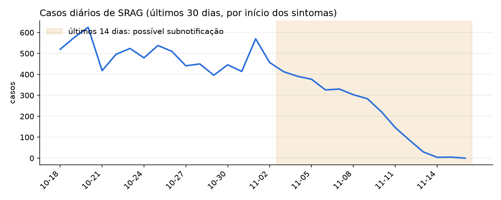
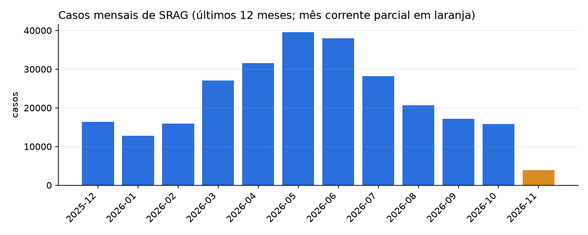

# Relatório de SRAG — dados até 2026-11-16

## Métricas
| Métrica | Valor | Detalhe | Janela | Origem (tool_call_id) |
|---|---|---|---|---|
| Taxa de aumento de casos | -10,6% | 15.125 vs 16.913 casos (bruta, sem ajuste de atraso: -34,2%) | 2026-10-04 a 2026-11-02 | call-1 |
| Taxa de mortalidade | 5,7% | 13.315 óbitos / 233.092 com desfecho (12,4% dos casos em aberto) | 2025-11-16 a 2026-11-02 | call-1 |
| Internações com passagem por UTI | 28,1% | 68.119 / 242.871 | 2025-11-16 a 2026-11-02 | call-1 |
| Casos vacinados (COVID-19) | 40,7% | 110.103 / 270.454 (98,8% de respostas válidas) | 2025-11-16 a 2026-11-02 | call-1 |

## Gráficos

## Contexto das notícias
- Notícias sugerem aumento de casos graves de SRAG por Covid-19 em seis estados, conforme [6] e [7]. ([fonte](https://news.google.com/rss/articles/CBMiYkFVX3lxTE9wd1pFVGt1bXVtcXFIMkpzSTF6S2tlRXgwYmxmQ1ROMHB4T2hwR0ZHeGZJa2V6LV9sd3pCR2ZPQ05xdnZPZHRRd3Jwbk05TU1pZmJ2bDcyUmtOUWtTY1F1NFRB?oc=5); [fonte](https://news.google.com/rss/articles/CBMiugFBVV95cUxObHh0U3RER2pBbURDVDJLdEdQVWxEckxkdURVTjRyNUx1c2FGZHZucTVQMjhVQUNzTzlSbTRZQUhfQ3JfbEFCS1ZVVVhOY1dEMkFTcEFFYUI4OFc4QjdMdEprZlRadFFaOU9xRm4ybWo0VTI5dTdwSHQ0UDNZSTg2cFRuTGZJbGdZcW1SR3BtRWw3Q25jUWFWYnppQVBJQ0R5VVNGSXNEb2VmUmsteDZCQ1RybjVfOGg5Umc?oc=5))
- Fiocruz identifica aumento de casos graves por três vírus respiratórios, conforme [8]. ([fonte](https://news.google.com/rss/articles/CBMi1wFBVV95cUxNN0hTVGFnb3pqWGxoRENCRzF5REFkLVlGejhLUU4xbDhsbGlsaTRCY211NWROUkEycldWUDl0NU4tSDZRRkQybWI0SEQ1bm9IRERKQldUMF9aU1lwRjhFcHAyOFk2cWN0SmJnWExfZjZ6MnJ1S3dvRzRwbXRSdzJReUVZaDkyVmFsQldYczlOTWdQRlp4TnczRGNRVndMczJWd2N1amJ3NWJtb242LVlTaXJNMWE5Qkc0MEFpQjBndk9NTHNKWEFVb2g2Q1dZMHhEM1VKOE5jZw?oc=5))
- Cinco estados estão em nível de risco para SRAG, conforme [5]. ([fonte](https://news.google.com/rss/articles/CBMirwFBVV95cUxOM1RyRk9BNUQ0aERoaFVNd1JXaHFCVVJrZmJvdTZPaXNBVHdWa0N2M0U1cmEya1NESFF5SEpncU5iRlJnUzBnUlh4N2kwR1V2U0Z0RkhHWTFLQTctejVQM0x4c2g5VTFYYU9CU05TMm9HemxXMlk4TEZhdFFnNGV5S0RKOHJUOTUydFd2eURsMFI3Sl9vaEhkcHBnUWphRjN2YkZjQlJrNkVxaTQ5a2d3?oc=5))
- Cresce o número de casos de SRAG por metapneumovírus, rinovírus e Covid-19, conforme [6]. ([fonte](https://news.google.com/rss/articles/CBMiYkFVX3lxTE9wd1pFVGt1bXVtcXFIMkpzSTF6S2tlRXgwYmxmQ1ROMHB4T2hwR0ZHeGZJa2V6LV9sd3pCR2ZPQ05xdnZPZHRRd3Jwbk05TU1pZmJ2bDcyUmtOUWtTY1F1NFRB?oc=5))

Notícias consultadas:
- [1] 2026-10-29 · Fundação Oswaldo Cruz (Fiocruz) · [InfoGripe: cinco estados têm SRAG em nível de alerta ou risco, com sinal de crescimento - Fundação Oswaldo Cruz (Fiocruz)](https://news.google.com/rss/articles/CBMirAFBVV95cUxNVldjcW9TYm1BVDFES3dpSEJpaFEzbndraWFtMkFEUzNSRldvU29NX1QwaEpWVGxZRHhTVkVUSXBEVDlBbFlaeEE2ZkNpWUlKX1h5S1BKNVc4TWt2QUVBbmRDWndZWkVnZ25BbG1uNk51bnd1cTRvRnZ2eDZRbVFnQjZIWkVmMUw4ZGZJRm1PS2hNNjBrWi1lbS1JRGtOM3MtRGZqcUNrZ3dvQldf?oc=5)
- [2] 2026-10-19 · G1 · [Sergipe é o único estado do país com nível de alerta de crescimento de Síndrome Respiratória Aguda Grave, diz Fiocruz - G1](https://news.google.com/rss/articles/CBMigwFBVV95cUxNUVhtaUdITEhfS3hib19zSzVXalp0R2JhQVZUamppbWRXVVZNVFBKejV5Q05rU1lJVVZydkFrX2ZkYXQ2MEFqdVNWczZQS0tJOXJKSWdyN3RHVUN3RzlBaDdBSnFndURGVi00eFlEaTlSU2ZsUm5lSkZybDRtNzlCRlM1Y9IBkgFBVV95cUxOb3daQVhPaHRYN2VHal8xY3JQM0d6ODgwLXJTa1ZlY21RMmx2cEljRXduZFg5MlJUMzd3N0dkSjFmRVJlU0JGd0xvSjdBaTFva3NER0g3c3czZDNPOXJQa243WDFXcjhEQkYyNy1OQzNyTjduc21xaGlzdGN3RF9tUDd4dGxKb2ZhSUJlNjFMSENGZw?oc=5)
- [3] 2026-11-07 · Agência Brasil · [Covid-19: pelo menos 5 estados registram aumento de casos graves - Agência Brasil](https://news.google.com/rss/articles/CBMiugFBVV95cUxOdHpINXVuU3J3Y1FZRVVSUFVTLTJjMXJmY2tCeWVYbTZNdUFsR0Jyd0h5WXlDbmJqLWtvQngtMmh5ajZGSFVsYk1XN1lmQmc3RXl1UC1MR2xrUldMMDZ1WC14Z3BSRUJvaV9NWVFtUlN3X0tOQjUwLW03LTFwaWNDaUVZRDR1NHVoaFhpaEkzbk4zcHJMa0hOenpTR3ZMdlp1RU1oYk1IRlZ2LXRDQVpTNmdrOVVfVGNzcmc?oc=5)
- [4] 2026-11-13 · COSEMS/SP · [Nota Técnica do COSEMS/SP nº 06 – Aumento de casos de SRAG por Covid-19 no estado de São Paulo - COSEMS/SP](https://news.google.com/rss/articles/CBMiygFBVV95cUxOUlNkQXBVLXVGdHNveVkzQWFNVVRzZDN1ZG9PN3Ayb0xZeWl3VERNYTRsUVVMVVNqN1RmQ0tVdXMwOHFRai1VakFQVmFHX0hjT0dxVDZFUkZGa0RFZWppMmVhX2lDRlFLX1BmeVg3MnFxQ3gxd2RnMHRlMnNJeThLYnFnaTBRYkx0OEo4QnNTdGVHQ0xlaEZRT0xLd2pVcExUNFZrVVdFRDRRNnhPVng0cGdOMUNMcHdWRzJZMlNjQjlsSmd0TWpTZUZR?oc=5)
- [5] 2026-10-30 · CNN Brasil · [Cinco estados do Brasil estão em nível de risco para síndrome respiratória - CNN Brasil](https://news.google.com/rss/articles/CBMirwFBVV95cUxOM1RyRk9BNUQ0aERoaFVNd1JXaHFCVVJrZmJvdTZPaXNBVHdWa0N2M0U1cmEya1NESFF5SEpncU5iRlJnUzBnUlh4N2kwR1V2U0Z0RkhHWTFLQTctejVQM0x4c2g5VTFYYU9CU05TMm9HemxXMlk4TEZhdFFnNGV5S0RKOHJUOTUydFd2eURsMFI3Sl9vaEhkcHBnUWphRjN2YkZjQlJrNkVxaTQ5a2d3?oc=5)
- [6] 2026-11-12 · Afya | Home · [InfoGripe da Semana: Covid-19 avança em seis UFs - Afya | Home](https://news.google.com/rss/articles/CBMiYkFVX3lxTE9wd1pFVGt1bXVtcXFIMkpzSTF6S2tlRXgwYmxmQ1ROMHB4T2hwR0ZHeGZJa2V6LV9sd3pCR2ZPQ05xdnZPZHRRd3Jwbk05TU1pZmJ2bDcyUmtOUWtTY1F1NFRB?oc=5)
- [7] 2026-11-05 · Fundação Oswaldo Cruz (Fiocruz) · [InfoGripe: cresce o número de casos de SRAG por metapneumovírus, rinovírus e Covid-19 - Fundação Oswaldo Cruz (Fiocruz)](https://news.google.com/rss/articles/CBMiugFBVV95cUxObHh0U3RER2pBbURDVDJLdEdQVWxEckxkdURVTjRyNUx1c2FGZHZucTVQMjhVQUNzTzlSbTRZQUhfQ3JfbEFCS1ZVVVhOY1dEMkFTcEFFYUI4OFc4QjdMdEprZlRadFFaOU9xRm4ybWo0VTI5dTdwSHQ0UDNZSTg2cFRuTGZJbGdZcW1SR3BtRWw3Q25jUWFWYnppQVBJQ0R5VVNGSXNEb2VmUmsteDZCQ1RybjVfOGg5Umc?oc=5)
- [8] 2026-11-10 · cff.org.br · [Fiocruz identifica aumento de casos graves por três vírus respiratórios no Brasil - cff.org.br](https://news.google.com/rss/articles/CBMi1wFBVV95cUxNN0hTVGFnb3pqWGxoRENCRzF5REFkLVlGejhLUU4xbDhsbGlsaTRCY211NWROUkEycldWUDl0NU4tSDZRRkQybWI0SEQ1bm9IRERKQldUMF9aU1lwRjhFcHAyOFk2cWN0SmJnWExfZjZ6MnJ1S3dvRzRwbXRSdzJReUVZaDkyVmFsQldYczlOTWdQRlp4TnczRGNRVndMczJWd2N1amJ3NWJtb242LVlTaXJNMWE5Qkc0MEFpQjBndk9NTHNKWEFVb2g2Q1dZMHhEM1VKOE5jZw?oc=5)

## Metodologia e limitações
- **Atraso de notificação:** as janelas ajustadas terminam 14 dias antes da data de referência; os últimos dias estão subnotificados (área laranja no gráfico diário).
- **Casos:** todos os registros, datados pelo início dos sintomas (DT_SIN_PRI).
- **Mortalidade:** óbitos por SRAG sobre casos com desfecho cura ou óbito; óbito por outras causas e casos sem desfecho ficam fora.
- **UTI:** a base não traz capacidade de leitos; o indicador é a proporção de internados que passaram por UTI, não ocupação.
- **Vacinação:** só há casos de SRAG, não a população; há viés de seleção e não é cobertura vacinal.
- **Privacidade:** o LLM recebeu somente agregados; data de nascimento, idade, município, UF e unidade foram descartados na ingestão.

## Auditoria
- run_id: `20261116T171715Z-ad0f04` · modelo: `qwen2.5:3b`
- dataset: INFLUD25-16-11-2026.parquet, INFLUD26-16-11-2026.parquet (ingerido em 2026-11-16, 585334 linhas, sha256 `d2364c8b7af0aa23…`)
- sha256 do log de auditoria: `6d7da6a959e3a7c4c77614b86ff6a9b5b9ef9c5b4d7397b07a2d645721f834c5`
- chamadas de tool: `{"get_metrics": "call-1", "generate_charts": "call-2", "search_news": "call-3"}`
